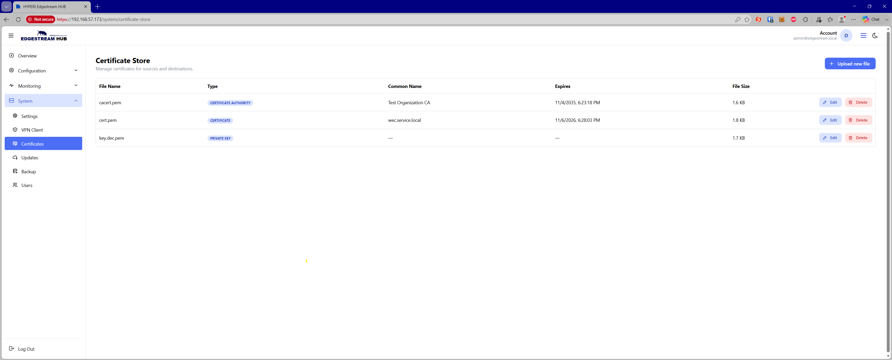

# 🔐 Certificate Store

The Certificate Store provides centralized management for SSL/TLS assets, including Certificate Authorities (CAs), public certificates, and private keys. Stored certificates are exposed directly to pipeline sources and destinations to enable secure mTLS, encrypted syslog, and authenticated API egress.

**Supported File Types**

Assets uploaded to the store are categorized into three core types:

* **Certificate Authority (`certificate_authority`)** — Root and intermediate CA bundles used to validate upstream sources or downstream destination servers.

* **Certificate (`certificate`)** — Public certificates used for server identification and client authentication.

* **Private Key (`private_key`)** — Cryptographic private keys associated with installed certificates.

Supported file extensions include `.crt`, `.pem`, `.cer`, `.key`, `.der`, `.pfx`, and `.p12`.

**Inventory & Telemetry Overview**

The store inventory table displays key operational metadata for every uploaded file:

* **File Name** — The system filename used to reference the certificate across pipeline configurations.

* **Type** — Badged classification (`Certificate Authority`, `Certificate`, or `Private Key`).

* **Common Name** — The primary domain or entity identity extracted from the certificate metadata.

* **Expires** — The exact expiration date and timestamp (`not_after`). Expired certificates are highlighted in bold red text to immediately surface validity issues.

* **File Size** — The size of the stored file on disk.

**Actions & Lifecycle Management**

* **Upload New File** — Upload a certificate or key file, designate its classification type, and commit it to the appliance storage.

* **Edit Record** — Modify the registered filename or change the assigned certificate type mapping.

* **Delete Record** — Open a confirmation dialog to permanently remove a certificate or key from the appliance.
