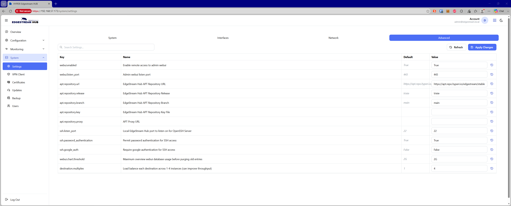

# 🛠️ Advanced Settings

The Advanced Settings page allows administrators to override default system configurations, customize internal package repositories, configure secure remote access, and fine-tune pipeline delivery throughput.

**Web UI & Metrics**

* **`webui.enabled`** — Enable or disable remote browser access to the EdgeStream administration console (Default: `True`).

* **`webui.listen_port`** — The listening port used by the administrative Web UI daemon (Default: `443`).

* **`webui.chart.threshold`** — Maximum allowable database storage utilization for dashboard metrics before automatic purge policies prune older telemetry (Default: `2G`).

**APT Package Repositories**

* **`apt.repository.url`** — Upstream APT repository endpoint for EdgeStream Hub system and package updates (Default: [https://apt.repo.hyperi.io/edgestream/stable](https://apt.repo.hyperi.io/edgestream/stable) ).

* **`apt.repository.release`** — Distribution release target for package updates (Default: `trixie`).

* **`apt.repository.branch`** — Configured package release branch (Default: `main`).

* **`apt.repository.key`** — GPG key path or signature used to verify repository package authenticity.

* **`apt.repository.proxy`** — Optional HTTP/HTTPS proxy URL used to route outbound package manager requests.

**SSH & Authentication Security**

* **`ssh.listen_port`** — Port on which the OpenSSH server listens for incoming management sessions (Default: `22`).

* **`ssh.password_authentication`** — Toggle standard password authentication on or off for incoming SSH connections (Default: `True`).

* **`ssh.google_auth`** — Require Google Authenticator two-factor authentication (2FA) for SSH terminal logins (Default: `False`).

**Pipeline & Delivery Tuning**

* **`destination.multiplex`** — Load balances event egress across 1 to 4 worker instances per configured destination to increase throughput and reduce downstream backpressure (Default: `1`).
