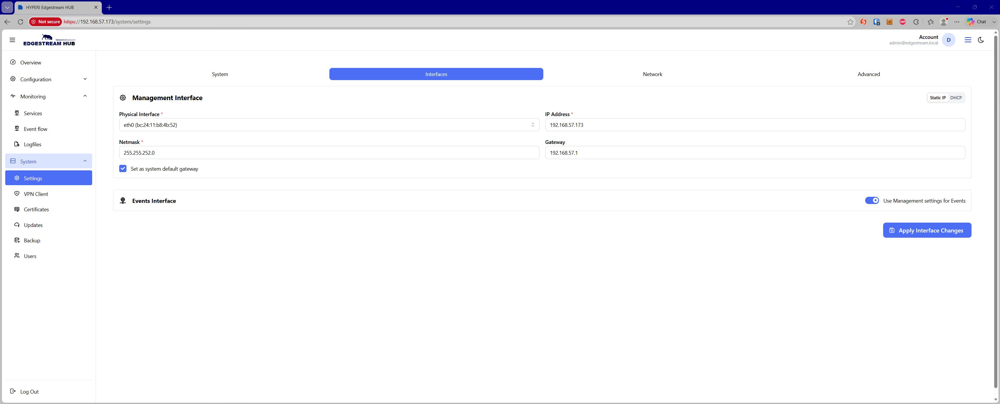

# 🌐 Interface Settings

The Interface Settings page allows administrators to configure IPv4 network parameters for the appliance's **Management** and **Events** network interfaces.

## 🛠️ Management Interface

The Management Interface handles administrative access, Web UI connectivity, API operations, and system daemons.

Configuration parameters include:

* **Protocol Mode** — Toggle between **Static IP** or **DHCP** addressing.

* **Physical Interface** — Select the target physical network device (displays the device name and detected MAC address).

* **IP Address** — The static IPv4 address assigned to the management interface (required in static mode).

* **Netmask** — The subnet mask for the management network (e.g., `255.255.255.0`).

* **Gateway** — The default network gateway for management traffic.

* **Default Gateway Checkbox** — Designates the management gateway as the primary system default route.

## 📡 Events Interface

The Events Interface handles high-volume telemetry ingestion and destination delivery traffic.

Administrators can operate in one of two routing modes:

* **Unified Interface (Default)** — When **Use Management settings for Events** is enabled, all event pipelines route through the management interface.

* **Dedicated Interface** — When disabled, an independent network adapter can be provisioned to isolate telemetry traffic from management operations.

Dedicated configuration options:

* **Protocol Mode** — Select **Static IP** or **DHCP**.

* **Physical Interface** — Select the dedicated physical device for event traffic.

* **IP Address & Netmask** — Independent IPv4 addressing and subnet assignment.

* **Gateway** — Optional dedicated gateway for telemetry routing.

* **Default Gateway Checkbox** — Sets this adapter as the default routing path for outbound event traffic.

## 💾 Applying Changes

Click **Apply Interface Changes** to submit the configuration and trigger the network provisioning job.

> **Warning:** Updating IP addresses, subnet masks, or default routes on the management interface may temporarily interrupt your active Web UI session while network adapters restart.
