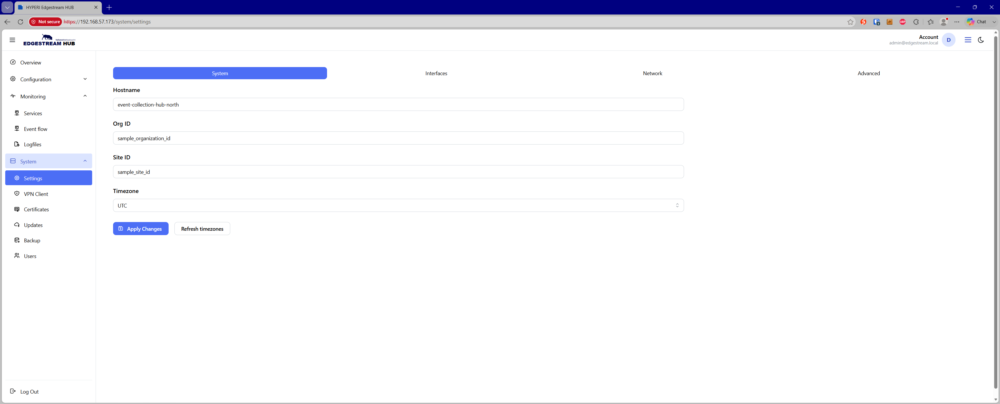

# ⚙️ System Settings

The System Settings page allows administrators to configure core identity and regional parameters for the EdgeStream Hub appliance.

## 🏷️ Global Event Metadata Enrichment

The parameters configured on this page are globally injected into the metadata of every event processed by the EdgeStream pipeline. This enables consistent multi-tenant routing, organization-level partitioning, and downstream query filtering.

The following metadata fields are appended automatically:

* `@edgestream.hub.host` — Configured appliance hostname

* `@edgestream.hub.organization` — Organization identifier

* `@edgestream.hub.id` — Deployment site or location identifier

* `@edgestream.hub.event.timezone` — Configured system timezone

## 🔧 Configuration Fields

Administrators can configure the following global settings:

* **Hostname** — The network hostname assigned to the EdgeStream Hub appliance (supports standard alphanumeric and hyphen characters).

* **Org ID** — A unique identifier representing the parent organization or tenant (supports alphanumeric, hyphen, and underscore characters).

* **Site ID** — A unique identifier representing the physical site, branch, or data center location (supports alphanumeric, hyphen, and underscore characters).

* **Timezone** — A searchable dropdown of standard timezones (e.g., `UTC`, `Australia/Melbourne`) used to standardize timestamp localization across outgoing events.

## 💾 Applying Changes

* Click **Apply Changes** to commit settings and trigger the background update job.

* Click **Refresh timezones** to re-poll and update the available system timezone database if local environment variables or time libraries change.
