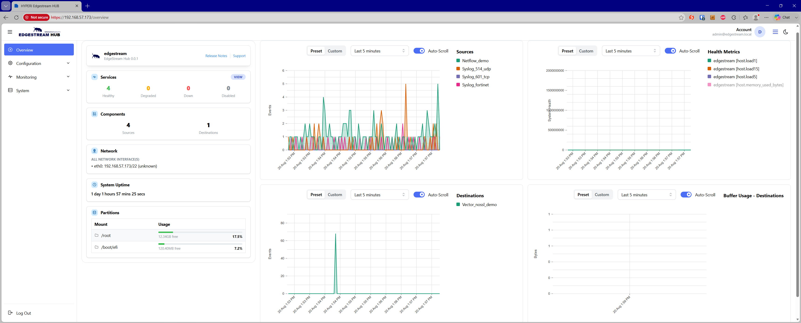

# EdgeStream Hub

**EdgeStream Hub** is an **event collection and aggregation appliance** designed for system administrators and platform operators who require reliable, flexible telemetry and observability pipelines.

It supports multiple input sources, real-time event filtering, and delivery to a wide range of destinations — all configurable through its built-in **web interface**.

---
## 🧩 Overview

EdgeStream Hub recieves or collects events from networking and application sources, applies filtering using its built-in processing pipeline, and forwards the resulting data to one or more destinations.

It is designed for use as a:

- **Log concentrator**
- **Telemetry gateway**
- **Event router**
- **Observability aggregation platform**

within enterprise, cloud, and hybrid infrastructure environments.

---

## 🌐 Web Interface

EdgeStream Hub provides an integrated **web administration and monitoring interface**.

The interface enables operators to:

- View active sources, transforms, and sinks
- Monitor throughput, buffering, and delivery metrics
- Manage configurations and reload pipelines
- Inspect logs and operational status in real-time
- Configure routing, filtering, and destination settings
- Manage VPN and remote connectivity integrations

This enables centralized operational control without requiring direct shell access to the host system.

---

## 📥 Supported Sources

EdgeStream Hub can receive events and telemetry from the following sources:

| Source                 | Description |
|------------------------|-------------|
| **Syslog**             | Collect system and application logs over UDP, TCP, or TLS |
| **Office 365 Audit**   | Ingest Office 365 audit and activity logs via Microsoft APIs |
| **AWS SQS**            | Consume messages and events from AWS SQS queues |
| **AWS S3**             | Ingest log files and telemetry data stored in AWS S3 buckets |
| **OpenTelemetry**      | Receive distributed tracing, logs, and metrics using OpenTelemetry protocols |
| **Fluentd**            | Accept structured events from Fluentd and Fluent Bit forwarders |
| **File**               | Read logs and structured data from local files |
| **Internal Metrics**   | Collect internal EdgeStream Hub operational and pipeline metrics |
| **Splunk HEC**         | Receive events using the Splunk HTTP Event Collector protocol |
| **NetFlow**            | Collect network flow telemetry including NetFlow and compatible flow protocols |
| **Beats (Logstash)**   | Receive data from Elastic Beats agents such as Filebeat and Metricbeat |
| **HTTP Server**        | Accept structured logs, metrics, or events via HTTP POST requests |
| **HTTP Client**        | Poll or fetch structured telemetry data from remote HTTP endpoints |
| **Vector**             | Receive observability data from Vector agents and pipelines |
| **TCP Socket**         | Ingest raw or structured streaming data over TCP |
| **UDP Socket**         | Ingest lightweight, stateless datagrams over UDP |
| **PostgreSQL Metrics** | Collect PostgreSQL database metrics and performance telemetry |
| **CEF**                | Receive events in Common Event Format (CEF) from security and SIEM platforms |
| **Host Metrics**       | Collect system-level CPU, memory, disk, and network metrics from hosts |

---

## 🔍 Event Filtering

EdgeStream Hub supports real-time event filtering, allowing administrators to:

- Include or exclude events based on conditions or field values
- Route events dynamically between destinations
- Convert logs into metrics

Filtering is performed in real-time, ensuring only relevant data continues through the pipeline.

---

## 📤 Supported Destinations (Sinks)

EdgeStream Hub supports the following output destinations:

| Destination      | Description |
|------------------|-------------|
| **Kafka**        | Publish events and telemetry to Apache Kafka topics |
| **File**         | Write events to local or network-mounted files |
| **ClickHouse**   | Store high-volume logs and telemetry in ClickHouse |
| **Vector**       | Relay observability data to another Vector or EdgeStream Hub instance |
| **AWS S3**       | Archive observability data to AWS S3 storage |
| **HTTP**         | Forward observability data to HTTP-based APIs and services |

---

## 🔒 Reliability and Deployment

EdgeStream Hub is designed for resilient, high-throughput deployments and includes:

- **TLS support** for encrypted data transport
- **Built-in buffering** and **backpressure handling**
- **Hot-reloadable configuration** for zero-downtime updates
- **Persistent queuing** support for reliable delivery
- **Container-ready deployment** using Docker or systemd services
- **Scalable pipeline architecture** for high-volume telemetry workloads

---

## 🌍 Connectivity and Remote Collection

EdgeStream Hub includes support for remote connectivity and distributed collection scenarios, including:

- Site-to-site and client VPN integrations
- Remote telemetry forwarding
- Secure encrypted transport between hubs and collectors
- Distributed event aggregation across multiple locations

---

## ⚖️ License

EdgeStream Hub is licensed under the **Functional Source License 1.1, ALv2 Future License** (`FSL-1.1-ALv2`).

Non-production, internal, evaluation, and community usage is permitted under the FSL license terms. Commercial competitive use requires a commercial license agreement.

- See [LICENSE](LICENSE) for the full license terms
- See [COMMERCIAL.md](COMMERCIAL.md) for commercial licensing requirements

SPDX Identifier: `FSL-1.1-ALv2`

---

© 2026 EdgeStream Hub. All rights reserved.