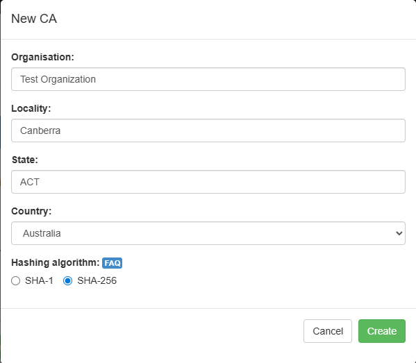
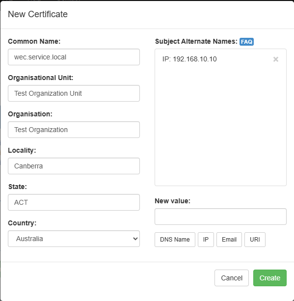

# Creating TLS Certs with TinyCert

Create an account and log into [tinycert](https://www.tinycert.org/).

## Certificate Authority

Under certificate authorities, select +Create...

Fill in appropriate values for the criteria and select Create:

Select the newly created certificate authority so it is visible.

Download the certificate. Click Download -> CA Certificate.

## Requests/Certificates

Under Requests/Certificates select +Create...

Fill in appropriate values for the criteria and select Create:

Download the certificate and private key. Select Download, and then download the Certificate and Private key (clear).

