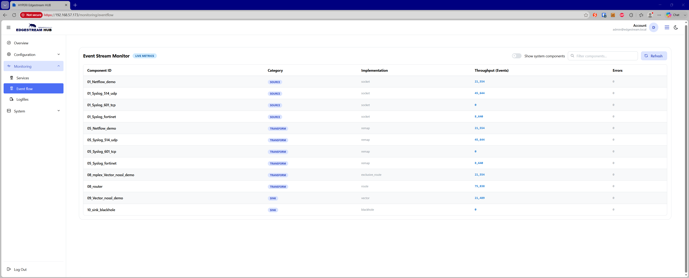

# 🔀 Event Flow Monitor

The Event Flow Monitor provides real-time visibility into telemetry throughput, pipeline performance, and error states across configured sources, transforms, and destinations.

## 🧭 Overview & Controls

The Event Flow interface offers direct insight into the health and volume of individual pipeline stages.

Controls include:

* **Show System Components** — Toggles the display of internal telemetry pipelines (components prefixed with `00_`), such as appliance health monitors and internal logging services.

* **Filter Components** — Real-time text search across component names, types, and implementations.

* **Refresh** — Manually triggers an immediate data refresh from the event monitor API.

* **Stream Status Badge** — Highlights whether the pipeline metrics stream is currently live or offline.

## 📊 Pipeline Metrics Breakdown

The monitor displays data across five key metrics for every active pipeline element:

* **Component ID** — The unique identifier assigned to the pipeline component.

* **Category** — The stage within the processing pipeline (`Source`, `Transform`, or `Sink/Destination`).

* **Implementation** — The underlying driver or protocol powering the component (e.g., `syslog`, `remap`, `elasticsearch`, `kafka`).

* **Throughput (Events)** — The total count of events processed and forwarded by the component.

* **Errors** — Total operational and delivery errors encountered. Components encountering issues are highlighted to streamline troubleshooting.

## 🔍 Performance Diagnostics

Administrators can sort table columns to rapidly diagnose bottlenecks:

* **Isolating Failures** — Sort by the **Errors** column to bring failing sources or destinations to the top.

* **Locating Bottlenecks** — Compare throughput across sequential transforms to locate filtering drop-offs or processing lag.

* **Auditing Load** — Sort by **Throughput** to identify high-volume feeds requiring load balancing or multiplexing.
